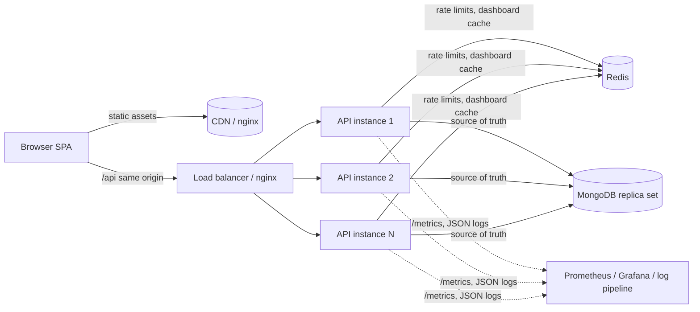

# Taskflow — Task Manager

A full-stack task manager built in TypeScript end to end: **React + Vite** frontend, **Express 5** API, **MongoDB** as the source of truth, and **Redis** for distributed rate limiting and a carefully scoped cache. Built for a MERN hiring assessment, with security, observability and capacity planning treated as first-class requirements.

> **What has been verified:** 107 automated tests pass (unit, integration against real MongoDB/Redis, Playwright end-to-end incl. axe accessibility checks); lint, strict type-checking and production builds pass; `npm audit --omit=dev` reports 0 vulnerabilities; GitHub Actions CI is green (checks, integration, E2E, Docker image builds); the full Docker Compose stack (web, API, MongoDB replica set, Redis, Prometheus, Grafana) was built, seeded and load-tested locally; k6 results and caveats are in [docs/scalability.md](docs/scalability.md).
> **What has not:** the 10,000 RPS target was **not** demonstrated — it needs multi-instance infrastructure that a single 8 GB laptop cannot provide.

---

## Contents

- **[How to run — step-by-step guide](docs/running.md)**
- [Features](#features)
- [Architecture](#architecture)
- [Tech stack](#tech-stack)
- [Quick start (local Node)](#quick-start-local-node)
- [Quick start (Docker Compose)](#quick-start-docker-compose)
- [Environment configuration](#environment-configuration)
- [Commands](#commands)
- [Testing](#testing)
- [API overview](#api-overview)
- [Security](#security)
- [Database and indexes](#database-and-indexes)
- [Performance, scaling and load testing](#performance-scaling-and-load-testing)
- [Deployment](#deployment)
- [Known limitations](#known-limitations)
- [Assessment decisions](#assessment-decisions)
- [Troubleshooting](#troubleshooting)

## Features

- **Accounts:** register, sign in, sign out, current user, change password (signs out other devices), delete account (re-authentication required).
- **Sessions:** 15-minute access JWT plus a rotating 7-day refresh token, both in HttpOnly cookies. Replaying a rotated refresh token revokes the whole session family. Absolute session lifetime is 30 days.
- **Tasks:** create, view, edit, delete; status (`todo` / `in_progress` / `completed`), priority, due date, tags, server-derived `completedAt`, and optimistic concurrency (`version`, stale edits get `409`).
- **Finding work:** paginated list with status / priority / tag / due-range / overdue filters, full-text search (title + description), and five sort orders. Filters live in the URL, so views are shareable and survive refresh.
- **Dashboard:** totals by status, overdue count, completion rate, upcoming deadlines (7 days), recent activity. Computed with index-backed queries and cached per user with generation-based invalidation.
- **UX:** responsive shell with a mobile drawer, skeleton loaders, empty and error states with retry, toasts, confirmation before deletes, optimistic checkbox toggling with rollback, keyboard and screen-reader support (Radix dialogs with focus trap and return, labelled controls, skip link).

## Architecture



A **modular monolith**: one deployable API with cohesive modules (`auth`, `users`, `tasks`, `dashboard`, `health`), each split into routes → thin controller → service → Mongoose model. API instances are stateless (JWT access tokens, sessions and limits in shared stores), so they scale horizontally behind any load balancer. See [docs/architecture.md](docs/architecture.md).

```
apps/
  api/        Express API (src/app.ts builds the app, src/server.ts owns the process lifecycle)
  web/        React SPA (features/auth, features/tasks, features/dashboard, features/settings)
packages/
  contracts/  Zod schemas + TypeScript types shared by API and web (runtime validation on both sides)
infrastructure/  nginx config, Prometheus/Grafana provisioning and alert rules
scripts/load-test.js   k6 scenarios
docs/          architecture, API, security, scalability, deployment, assessment decisions
```

## Tech stack

| Layer | Choices |
| --- | --- |
| Frontend | React 18, Vite 6, TypeScript (strict), Tailwind CSS 3, React Router 7, TanStack Query 5, React Hook Form + Zod, Radix UI primitives (shadcn-style components), Lucide icons, Sonner toasts |
| Backend | Node.js 22+, Express 5, TypeScript (strict), Mongoose 8, Zod 4, Argon2id, jose (JWT), Helmet, express-rate-limit with a Redis-backed store, Pino, prom-client |
| Data | MongoDB 7/8 (replica set in Compose and production), Redis 7+ |
| Testing | Vitest, Supertest, React Testing Library, Playwright + axe-core, k6 |
| Ops | Docker (multi-stage, non-root), Docker Compose, GitHub Actions, Prometheus + Grafana |

## Quick start (local Node)

> Full walkthrough: prerequisites per OS, Docker, tests, load tests, troubleshooting in **[docs/running.md](docs/running.md)**.

**Prerequisites:** Node.js ≥ 22.12 with npm ≥ 10, MongoDB ≥ 7 on `localhost:27017`, Redis ≥ 7 on `localhost:6379`. Redis is optional: without it the API runs with per-instance rate limits and no dashboard cache. To get MongoDB and Redis from Docker instead: `docker compose up -d mongo redis`.

```bash
git clone <repo-url> taskflow && cd taskflow
npm ci

# 1. Configure (generates two random secrets into .env)
cp .env.example .env
node -e "const c=require('crypto'),f=require('fs');let s=f.readFileSync('.env','utf8');for(const k of ['ACCESS_TOKEN_SECRET','COOKIE_SECRET'])s=s.replace(new RegExp('^'+k+'=.*','m'),k+'='+c.randomBytes(48).toString('base64url'));f.writeFileSync('.env',s)"

# 2. Seed demo data (creates indexes too)
npm run seed                       # demo@taskmanager.dev / DemoPassword2026
npm run seed -- --loadtest 200     # optional: + 200 load-test accounts (~36k tasks)

# 3. Run (two terminals)
npm run dev:api                    # http://localhost:4000   (health: /health/ready)
npm run dev:web                    # http://localhost:5173   (proxies /api to :4000)
```

Open <http://localhost:5173> and sign in with the demo account. The sign-in page has a "fill demo credentials" shortcut in development builds.

## Quick start (Docker Compose)

```bash
cp .env.example .env        # then set ACCESS_TOKEN_SECRET and COOKIE_SECRET (see above)
docker compose up --build -d
docker compose run --rm api node dist/seed.js
open http://localhost:8080   # nginx serves the SPA and proxies /api to the API
docker compose --profile monitoring up -d   # optional: Prometheus :9090, Grafana :3000 (GRAFANA_PORT / PROMETHEUS_PORT to change)
```

Compose runs MongoDB as a single-node **replica set** with a persistent volume, Redis with AOF persistence, health-checked startup ordering, and publishes MongoDB, Redis and the API on `127.0.0.1` only. If ports 27017/6379 are already in use, set `MONGO_PORT` / `REDIS_PORT`.

## Environment configuration

All configuration is validated at startup by [`apps/api/src/config/env.ts`](apps/api/src/config/env.ts). The process exits with a list of the offending keys (never their values). In `NODE_ENV=production` it additionally refuses placeholder or identical secrets, non-HTTPS origins and non-Secure cookies. [`.env.example`](.env.example) documents every variable. The important ones:

| Variable | Purpose | Default |
| --- | --- | --- |
| `MONGODB_URI` | MongoDB connection string (use a least-privilege `readWrite` user) | — (required) |
| `REDIS_URL` | Redis; omit to run degraded | unset |
| `ACCESS_TOKEN_SECRET`, `COOKIE_SECRET` | JWT signing key and CSRF HMAC key, ≥ 32 chars, distinct | — (required) |
| `WEB_ORIGIN` | Comma-separated allowed browser origins (CORS) | `http://localhost:5173` |
| `ACCESS_TOKEN_TTL` / `REFRESH_TOKEN_TTL` / `SESSION_ABSOLUTE_TTL` | Session lifetimes (seconds) | 900 / 604800 / 2592000 |
| `TRUST_PROXY` | Number of trusted proxy hops for client IPs | `0` |
| `RATE_LIMIT_*`, `AUTH_RATE_LIMIT_*`, `LOGIN_ACCOUNT_RATE_LIMIT_MAX`, `SEARCH_RATE_LIMIT_MAX` | Abuse limits | 300/min, 30/15 min, 10/15 min, 120/min |
| `MAX_IN_FLIGHT`, `REQUEST_TIMEOUT_MS`, `DB_QUERY_TIMEOUT_MS` | Backpressure and deadlines | 2000, 10 s, 5 s |
| `DASHBOARD_CACHE_TTL_SECONDS` | Dashboard cache TTL (0 disables) | 60 |
| `METRICS_TOKEN` | Bearer token for `/metrics` (disabled in production if unset) | unset |

## Commands

| Command | What it does |
| --- | --- |
| `npm run dev:api` / `npm run dev:web` | Run the API (tsx watch) / the SPA (Vite) |
| `npm run build` | Bundle the API (`apps/api/dist`) and build the SPA (`apps/web/dist`) |
| `npm run typecheck` · `npm run lint` · `npm run format:check` | Strict TS, ESLint, Prettier |
| `npm run seed [-- --loadtest N]` | Demo data (+ N isolated load-test accounts) |
| `npm run db:indexes [-- --dry-run \| --drop-extraneous]` | Controlled index deployment |
| `npm run db:explain` | `explain("executionStats")` for every production query shape |
| `npm run load:smoke` | k6 smoke test (safe locally) |

## Testing

```bash
npm run test:unit          # contracts (13) + API unit (25) + web components/hooks (14)
npm run test:integration   # API against real MongoDB + Redis (51); MONGODB_URI_TEST overrides the server
npm run test:e2e           # Playwright: starts its own API (:4100, db taskmanager_e2e) and Vite (:5174)
npm test                   # unit + integration
```

Integration tests create a uniquely named database per test file on the real server, build the production indexes, and drop it afterwards. They cover auth flows (rotation, reuse detection, expiry, logout revocation, password change), task CRUD, pagination, filters, text search, sorting, optimistic concurrency, cross-user isolation on every operation, mass assignment, NoSQL operator injection (body, query, update-pipeline expressions), CSRF, rate limiting (IP, account, user), body-size and content-type limits, security headers, CORS, health/readiness, and the Redis cache's invalidation and per-user isolation.

E2E tests run the ten required user journeys end to end, a two-user isolation check, a mobile-navigation check, and axe WCAG 2 A/AA scans (no serious or critical violations).

**Results at submission:** all 107 tests pass. Details are in [docs/assessment-decisions.md](docs/assessment-decisions.md#verification-summary).

## API overview

REST under `/api/v1`. Success responses are `{ data, meta? }`; errors are `{ error: { code, message, requestId, details? } }`. Full reference: [docs/api.md](docs/api.md).

| Method | Path | Auth | Notes |
| --- | --- | --- | --- |
| GET | `/api/v1/auth/csrf` | – | Issues the CSRF cookie and token |
| POST | `/api/v1/auth/register` · `/login` · `/refresh` · `/logout` | – | `register` returns 201; `logout` returns 204 |
| GET | `/api/v1/auth/me` | ✓ | Current user |
| POST | `/api/v1/auth/change-password` | ✓ | Revokes other sessions |
| DELETE | `/api/v1/users/me` | ✓ | Body `{ password }`; returns 204 |
| GET / POST | `/api/v1/tasks` | ✓ | List (paginated, filtered) / create (201 + `Location`) |
| GET / PATCH / DELETE | `/api/v1/tasks/:id` | ✓ | PATCH requires `version` (409 on conflict) |
| PATCH | `/api/v1/tasks/:id/status` | ✓ | Idempotent status set |
| GET | `/api/v1/dashboard/summary` | ✓ | Cached per user |
| GET | `/health/live` · `/health/ready` · `/metrics` | – / – / token | Probes and Prometheus metrics |

## Security

Summary (details and threat model in [docs/security.md](docs/security.md)):

- Argon2id password hashing (19 MiB, t=2), with timing equalization for unknown emails and generic credential errors.
- HttpOnly cookies only. The access cookie is `SameSite=Lax`; the refresh cookie is `SameSite=Strict` and scoped to `/api/v1/auth`. Nothing sensitive is stored in localStorage.
- Signed double-submit CSRF tokens on every state-changing request, plus a JSON-only body requirement (415 otherwise).
- Ownership is part of every database query (`{ _id, userId }`). Other users' tasks return 404, never 403.
- Zod allowlists everywhere (`.strict()`, unknown params rejected). Filters are built only from validated primitives, and update-pipeline values are wrapped in `$literal`, so operator injection is impossible by construction.
- Helmet with `default-src 'none'` on the API and a strict script CSP on the SPA, CORS allowlist with credentials, 16 KB body limit, no `x-powered-by`, explicit `trust proxy` hop count.
- Layered rate limits backed by Redis with a per-instance fallback, logs with secrets redacted, and secrets validated at startup.

## Database and indexes

| Collection | Index | Serves |
| --- | --- | --- |
| users | `{ email: 1 }` unique | Login lookup; uniqueness enforced by the DB |
| tasks | `{ userId, updatedAt: -1, _id: -1 }` | Default list, recent activity, counts |
| tasks | `{ userId, status, updatedAt: -1, _id: -1 }` | Status filter; **covered** dashboard status counts |
| tasks | `{ userId, dueDate, _id }` | Due sort, overdue, upcoming, due ranges |
| tasks | `{ userId, createdAt: -1, _id: -1 }` | "Newest first" |
| tasks | `{ userId, priorityRank: -1, _id: -1 }` | Priority sort (added after `explain` showed a blocking sort) |
| tasks | `{ userId, title: text, description: text }` | Search (equality-prefixed text index) |
| sessions | `tokenHash` unique, `familyId`, `userId`, TTL on `expiresAt` | Refresh rotation, family revocation, expiry |

Every task index starts with `userId`, because every query is tenant-scoped. The trailing `_id` matches the API's stable sort, so pagination never needs an in-memory sort. Verified with `npm run db:explain` against a user with 2,976 tasks: every list query examines about 20 keys for 20 results, and status counts are index-only (0 documents fetched). See [docs/architecture.md#indexes](docs/architecture.md#indexes) for the plans and write-cost trade-offs.

## Performance, scaling and load testing

```bash
npm run seed -- --loadtest 200
# API with load-test limits (the normal limits correctly reject generated traffic):
RATE_LIMIT_MAX=10000000 AUTH_RATE_LIMIT_MAX=100000 LOGIN_ACCOUNT_RATE_LIMIT_MAX=100000 SEARCH_RATE_LIMIT_MAX=10000000 npm run dev:api
k6 run -e SCENARIO=smoke scripts/load-test.js
k6 run -e SCENARIO=mixed -e RATE=500 -e DURATION=60s scripts/load-test.js
k6 run -e SCENARIO=staged -e STAGES=100,500,1000,2500,5000,10000 scripts/load-test.js   # dedicated infra only
```

Measured on one laptop (Apple M2, 8 GB RAM; k6, MongoDB, Redis and **one** API process all on the same machine):

| Scenario | Achieved | p95 | p99 | Errors |
| --- | --- | --- | --- | --- |
| `GET /health/live` | 9,999 req/s | 0.7 ms | 12.6 ms | 0% |
| Authenticated task list (8 query shapes) | ~950 req/s | 4.7–57 ms¹ | 24–216 ms¹ | 0% |
| Dashboard, warm cache | 1,445 req/s | 1.1 ms | 13.1 ms | 0% |
| Dashboard, cache disabled | 953 req/s | 4.9 ms | 25.3 ms | 0% |
| Write cycle (create → update → complete → delete) | 388 writes/s | 3.0 ms | 19.0 ms | 0% |
| Mixed 80/20 read/write | 829 req/s | 15.8 ms | 46.4 ms | 0% |
| Mixed, Redis killed mid-run | 568 req/s | 3.8 ms | 19.8 ms | **0%** |

¹ Two runs; the laptop was swapping during the slower one. One API process saturates at about 1,350 list req/s, limited by the Node event loop. The full analysis, the cost model for 10,000 RPS (≈ 16 API vCPUs plus a 3-node replica set) and the production validation procedure are in **[docs/scalability.md](docs/scalability.md)**.

## Deployment

The target layout is the SPA on object storage + CDN, `/api/*` routed by a managed load balancer to N stateless API containers, MongoDB Atlas (replica set, PITR backups) and managed Redis. TLS terminates at the load balancer. The rolling deploy, rollback, secrets, index rollout and runbooks are in [docs/deployment.md](docs/deployment.md).

## Known limitations

- **10,000 RPS not demonstrated.** Single-machine results only; [docs/scalability.md](docs/scalability.md) gives the capacity model and test plan.
- **Revocation latency.** Access tokens are verified statelessly, so a revoked session's access token stays valid for up to 15 minutes. This is the main limitation I would address next; see [docs/assessment-decisions.md](docs/assessment-decisions.md#c-implementation-limitation).
- **No email flows.** There is no password reset or email verification (no email provider is configured), which also means registration necessarily reveals whether an email is taken (rate limited).
- **Offset pagination.** Deep pages cost O(offset); every list also runs a `countDocuments`. Cursor pagination is the documented next step.
- **Search is word-based.** The MongoDB text index matches stemmed words, not substrings or typos.
- **Undated tasks sort first** under "Due date" ascending (MongoDB orders `null` before dates).

## Assessment decisions

Three engineering decisions, three deliberately unimplemented features, the main limitation, and the video script are in **[docs/assessment-decisions.md](docs/assessment-decisions.md)**.

## Troubleshooting

| Symptom | Fix |
| --- | --- |
| API exits with `Invalid environment configuration` | The listed keys are missing or invalid. Secrets must be ≥ 32 chars; production also requires https origins. |
| `/health/ready` returns 503 `mongo: down` | MongoDB is unreachable. The API keeps retrying with backoff; data routes return 503 + `Retry-After` until then. |
| Logged in but every write returns 403 `CSRF_INVALID` | The `tm_csrf` cookie is missing (e.g. cleared). The SPA refetches it automatically; for curl, GET `/api/v1/auth/csrf` first and send the token as `X-CSRF-Token`. |
| 429 everywhere during load tests | Expected with default limits. Start the API with the load-test limits shown above. |
| `npm ci` warns about install scripts | npm ≥ 11 asks to approve native builds; `argon2` and `esbuild` are pre-approved in `package.json#allowScripts`. |
| Playwright cannot find a browser | `cd apps/web && npx playwright install chromium` |
| Ports 27017/6379 busy under Compose | `MONGO_PORT=27018 REDIS_PORT=6380 docker compose up -d` |
