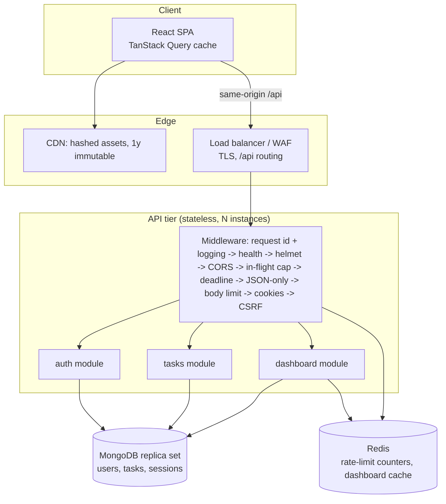

# Architecture

## Overview



### Why a modular monolith

The domain is small and cohesive: users own tasks, and the dashboard summarizes tasks. Splitting it into services would add network hops, distributed failure modes and deployment overhead without isolating anything that scales differently. The API is still built to scale out:

- **Stateless instances.** Access tokens are self-contained JWTs, refresh sessions live in MongoDB, and rate-limit counters and cache entries live in Redis. Any instance can serve any request, so instances can be added or replaced freely.
- **Module boundaries are explicit.** Each module has `routes` (wiring and middleware), a thin `controller` (HTTP to service), a `service` (business rules, validation through shared contracts) and a `model`. Cross-module use goes through services (for example, auth's account deletion uses the task model deliberately and visibly).
- **Composition root.** `createApp({ config, redis, state })` in `app.ts` builds every service and router from explicit dependencies. `server.ts` owns process concerns: the port, MongoDB connection retries, signals, and shutdown. Tests build apps with different configs (rate limits on or off, cache on or off) without touching globals.

### Shared contracts

`packages/contracts` contains Zod schemas and TypeScript types used by both sides: request schemas (`createTaskSchema`, `listTasksQuerySchema`, `registerSchema`, …), enums and limits, and response DTO types. The web app uses them for form validation and typing; the API uses them as the runtime validation boundary. They contain no server code, so the frontend is not coupled to implementation details. The package ships TypeScript source; Vite and tsup bundle it, so there is no separate build step.

## Request lifecycle

1. **Request id and logging.** An incoming `X-Request-Id` is accepted if it matches a safe pattern; otherwise a UUID is generated. The id is echoed in the response and included in every log line and error body. Pino logs the method, path without query string, status, duration and user id. Credentials are redacted.
2. **Health and metrics** sit before load shedding, so probes keep answering under pressure.
3. **Helmet and CORS.** The API returns only JSON, so its CSP is `default-src 'none'`. Credentialed CORS is limited to configured origins.
4. **Backpressure.** If more than `MAX_IN_FLIGHT` requests are in progress on an instance, it answers 503 with `Retry-After` immediately. A `REQUEST_TIMEOUT_MS` deadline answers 503 `TIMEOUT` if a handler stalls.
5. **Input hygiene.** Bodies must be `application/json` (415 otherwise) and at most 16 KB (413).
6. **CSRF** check on unsafe methods, then per-router `authenticate` (JWT verification, no database round trip) and the per-user rate limiter.
7. **Controller → service.** The service parses input with the shared schema; a `ZodError` becomes a 400 with field details.
8. **Errors** pass through one `toAppError` mapper: AppError as-is; Zod errors to 400; body-parser errors to 400/413/415; duplicate keys to 409; MongoDB unavailability and pool timeouts to 503 + `Retry-After`; `maxTimeMS` expiry to 503 `TIMEOUT`; everything else to a generic 500 that includes the request id but no internals.

## Data model

```ts
User    { _id, name, email (unique, lowercase), passwordHash (select: false), passwordChangedAt, createdAt, updatedAt }
Task    { _id, userId (immutable), title ≤200, description ≤5000, status, priority, priorityRank 1..3,
          dueDate: Date|null (UTC instant), tags: string[] ≤10, completedAt: Date|null, version, createdAt, updatedAt }
Session { _id, userId, familyId, tokenHash (sha256), expiresAt (TTL), absoluteExpiresAt, replacedAt, revokedAt, userAgent, createdAt }
```

- **Ownership.** Tasks reference users by `userId`. There are no joins: every read is "this user's tasks", so the task document carries everything a response needs.
- **Concurrency.** `version` is an optimistic concurrency token. A general update is a compare-and-set (`{ _id, userId, version }`) implemented as a single atomic update pipeline that increments `version` and recomputes `completedAt`. A miss is then classified as 404 (not found or not yours) or 409 `VERSION_CONFLICT`. Status changes are idempotent "set" operations without a version.
- **Derived fields.** `completedAt` is set once when a task becomes completed (`$ifNull` keeps the original time if it is completed again) and cleared when it is reopened. `priorityRank` lets "sort by priority" order high > medium > low through an index.
- **Time.** Timestamps are UTC. A due date is the instant at the **end of the selected local day** (computed in the browser), so "due Friday" becomes overdue at the user's own midnight.
- **Strictness.** Schemas use `strict: 'throw'`; fields such as `userId` are `immutable`; client values in update pipelines are wrapped in `$literal`.
- **Deletion and retention.** Deleting a task is a hard delete. Deleting an account removes its sessions, then its tasks, then the user. Each step is idempotent, so a partial failure is fixed by retrying, and a usable login can never remain because sessions go first. Sessions expire through a TTL index. No soft-delete or audit history is kept; that would be a product decision.
- **Transactions** are not used. No operation needs multi-document atomicity: rotation is a single-document conditional update followed by an insert, and an orphaned new session from a crash is harmless.

## Indexes

Index choices follow the implemented query shapes and were verified with `npm run db:explain` (seeded dataset: 200 load-test users, 36,273 tasks; the heaviest user has 2,976 tasks):

| Query | Winning plan | Keys / docs examined for the result |
| --- | --- | --- |
| list, default sort (`updatedAt` desc) | `IXSCAN(user_updated) → FETCH → LIMIT` | 20 / 20 for 20 |
| list page 5 | `IXSCAN(user_updated) → SKIP → FETCH` | 100 / 20 for 20 |
| filter by status | `IXSCAN(user_status_updated)` | 20 / 20 for 20 |
| sort by due date / created | `IXSCAN(user_due)` / `IXSCAN(user_created)` | 20 / 20 for 20 |
| sort by priority — **before** adding `user_priority` | `IXSCAN(user_updated) → FETCH → SORT` | **2,976 / 2,976 for 20 (57 ms)** |
| sort by priority — after | `IXSCAN(user_priority)` | 20 / 20 for 20 (0 ms) |
| overdue | `IXSCAN(user_updated)` + filter | 98 / 98 for 20 |
| text search "report" | `IXSCAN(user_text) → TEXT_MATCH → SORT` | 243 / 243 for 20 |
| list total (`countDocuments`) | `COUNT_SCAN(user_updated)` | 2,976 keys, 0 docs |
| dashboard status counts | `IXSCAN(user_status_updated) → PROJECTION_COVERED → GROUP` | 2,976 keys, **0 docs** |
| dashboard overdue count | `IXSCAN(user_due) → FETCH` | 776 / 776 |
| dashboard upcoming | `IXSCAN(user_due)` | 6 / 6 for 5 |

Design rules:

- **Equality first.** `userId` is the leading key everywhere, so each query is confined to one tenant's key range. This is also the natural shard-key prefix (see scalability).
- **Sort keys match the index**, including the `_id` tie-breaker, so offset pages are deterministic and never sorted in memory.
- **No index for every combination.** Priority/status/tag *filters* without a matching sort are served by scanning one user's index range and filtering. That is bounded by the per-user task count and cheaper overall than more write amplification. Title sort uses a case-insensitive collation and stays an in-memory top-k sort.
- **Costs.** Tasks carry 6 secondary indexes + `_id`. Each insert and delete touches 7 B-trees, and a multikey text index adds one entry per distinct term. Updates touch only the indexes whose keys change (`updatedAt` is in three of them). For ~0.4 KB documents the indexes take roughly as much space as the data. This is the main reason the API does not index every filter combination.
- **Deployment.** `autoIndex` is on outside production and off in production, where `npm run db:indexes` shows a diff and creates missing indexes as an explicit release step. `--drop-extraneous` removes indexes that are no longer defined.

## Caching

Only one application cache exists, and it is deliberate: the per-user **dashboard summary** (4 queries, read on every dashboard visit, invalidated on every task mutation).

| Concern | Design |
| --- | --- |
| Keys | `tm:dash:<userId>:g<generation>` and `tm:dashgen:<userId>`. The user id comes only from the verified token and must match `^[a-f0-9]{24}$` before a key is built. |
| Invalidation | Every create/update/status/delete increments the user's generation (`INCR` + `EXPIRE` in one `MULTI`). A summary computed from stale data can only be written under an older generation that no reader asks for again, which avoids the "delete, then stale re-populate" race without locks. |
| TTL | 60 s ± 10 % jitter. That bounds staleness for time-driven changes (a task becoming overdue without any write) and spreads expirations. |
| Stampede | Per-instance single-flight: concurrent misses for the same key share one computation. |
| Redis down or slow | 150 ms command timeout, no offline queue. Reads fall back to computing directly (`bypass`); a failed invalidation is logged and bounded by the TTL. MongoDB remains the source of truth. |
| Size | One small JSON per active user, TTL-bounded. Compose sets `maxmemory 256mb` with `volatile-lru`. |
| Metrics | `cache_operations_total{result=hit|miss|bypass|error|invalidate}`, `redis_command_duration_seconds` |

Task lists are **not** cached. They have many filter combinations, change on every write, and are already served in ~1–5 ms from indexes, so caching them would add invalidation complexity without a measured need.

## Frontend architecture

- **Server state** lives in TanStack Query with stable keys (`['tasks','list', filters]`, `['dashboard','summary']`, `['auth','me']`). Retries happen only for network/5xx errors, at most twice with jittered backoff; mutations are never retried automatically. Superseded list requests are cancelled through the `AbortSignal`, and `keepPreviousData` avoids layout flashes between pages.
- **The URL is the filter state.** `filtersFromParams` validates every parameter against the shared enums, and the search box is debounced by 300 ms.
- **Session handling.** `lib/api.ts` attaches the CSRF header, and on a 401 performs one single-flight `/auth/refresh` and replays the request. If the refresh fails, it emits a session-expired event; the auth provider then clears user data and the route guard redirects to `/login`. Route guards exist only for UX; authorization happens on the server.
- **Optimistic updates** only for the status checkbox, where rollback is straightforward. A snapshot of every cached list is restored on error, then lists refetch.
- **Code splitting.** Every page is a lazy route chunk; vendor chunks are split into react, query and forms. The production JS is about 170 KB gzip in total, and the largest page chunk is 15 KB.
