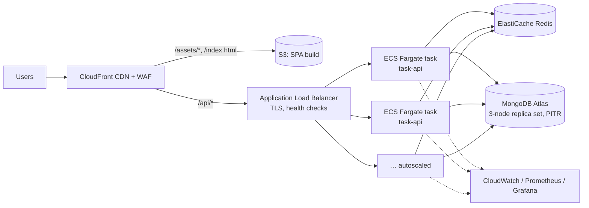

# Deployment and operations

## Target topology (AWS example; any managed cloud is equivalent)

- **One hostname**, with the CDN routing paths: `/api/*` goes to the ALB (no caching; the API sends `no-store`), everything else to S3. Same origin means no CORS, and the SameSite cookies behave as designed. Assets are content-hashed and served with `Cache-Control: public, max-age=31536000, immutable`; `index.html` uses `no-cache`.
- **TLS** terminates at CloudFront and the ALB (ACM certificates). The API runs with `NODE_ENV=production`, `COOKIE_SECURE=true` (enforced), `TRUST_PROXY=2` (CloudFront → ALB) and `WEB_ORIGIN=https://tasks.example.com`.
- **API tasks:** the container from `apps/api/Dockerfile` runs as non-root behind tini, at 1 vCPU / 1 GB per task (one Node process per vCPU), with autoscaling on ALB request count per target or on CPU at 60 %. The minimum is 2 tasks across 2 AZs. ALB health check: `/health/ready`; container health check: `/health/live`; deregistration delay 25 s, which is longer than the app's drain.
- **MongoDB Atlas:** a 3-node replica set across AZs, `w: majority`, continuous backups with point-in-time restore, private endpoint or VPC peering only (no public IP access list), and a dedicated `readWrite` user for the app plus a separate role for index builds.
- **Redis:** ElastiCache with a replica and automatic failover, in-transit encryption and AUTH, reachable only from the API security group. Losing it degrades rather than breaks the service.
- **Secrets:** AWS Secrets Manager or SSM Parameter Store, injected as environment variables by the ECS task definition. Never baked into images, never stored in the repo.
- **Kubernetes** works the same way (Deployment + HPA, readiness and liveness probes on the two health endpoints, `terminationGracePeriodSeconds: 30`, a PodDisruptionBudget), but it is not required; manifests are intentionally not included.

## Environments

| | development | test (CI) | production |
| --- | --- | --- | --- |
| `NODE_ENV` | development | test | production |
| Cookies | not Secure (http://localhost) | not Secure | **Secure required** |
| Indexes | `autoIndex` on | created by test setup | **explicit `db:indexes` step** |
| Rate limits | default | off (except dedicated tests) | default, tuned |
| `/metrics` | open | open | **bearer token or disabled** |
| Secrets | `.env` (random, local) | fixed test values | secret manager, ≥ 32 chars, validated |

## Release process

1. CI (`.github/workflows/ci.yml`) on every PR: install from the lockfile → format → lint → typecheck → unit tests → build → `npm audit --omit=dev --audit-level=high`; integration tests against MongoDB and Redis service containers; Playwright E2E; Docker image builds.
2. On merge to main: build and push images tagged with the commit SHA (immutable tags) and upload the SPA build to a versioned S3 prefix.
3. **Index step:** `node dist/sync-indexes.js --dry-run`, review, then `node dist/sync-indexes.js` (creates missing indexes; MongoDB builds them online). Run it **before** shipping code that relies on a new index. Drop old indexes in a later release with `--drop-extraneous`, once no deployed version uses them.
4. **Rolling deploy:** ECS rolling update with `minimumHealthyPercent=100, maximumPercent=200`. New tasks must pass `/health/ready` before receiving traffic, and old tasks drain on SIGTERM. Use the deployment circuit breaker with automatic rollback.
5. **SPA:** switch the CloudFront origin path to the new prefix and invalidate `/index.html` only. Old hashed assets stay available, so clients loaded before the switch keep working.
6. **Rollback:** redeploy the previous image tag (and the previous SPA prefix). Schema changes are additive by policy (new optional fields, new indexes), so older code keeps working against the newer database.

## Backups and recovery

- Atlas continuous cloud backup: hourly snapshots plus oplog-based **point-in-time restore** (e.g. a 7-day window); snapshots retained 30 days. Restore drills each quarter into a scratch cluster.
- Redis holds no system-of-record data and is not backed up. On loss, limits reset and the cache refills.
- RPO ≈ seconds (PITR); RTO ≈ the restore time for the data size (minutes for this dataset). Document and rehearse both.

## Resource guidance

| Component | Per unit | Notes |
| --- | --- | --- |
| API task | 1 vCPU, 512 MB–1 GB | Observed 240–285 MB RSS under load; alert at 450 MB |
| nginx (self-hosted variant) | 0.25 vCPU, 64 MB | The Compose `web` service |
| MongoDB | see [scalability.md §3](scalability.md#3-capacity-model-for-10000-rps-estimate-to-be-validated) | Size by working set and write IOPS |
| Redis | 1–2 GB | Dashboard cache ≈ 2 KB per active user, plus counters |

## Observability

- **Logs:** JSON to stdout (Pino), one line per request with `req.id`, method, path, status, `responseTime` and `userId`. Ship them with the platform log driver (CloudWatch, Datadog, Loki). Search by the `requestId` users see in error messages.
- **Metrics:** `/metrics` (Prometheus): `http_request_duration_seconds{method,route,status}` (route templates only), `http_requests_in_flight`, `http_load_shed_total{reason}`, `rate_limit_rejections_total{limiter}`, `rate_limit_store_fallback_total`, `cache_operations_total{result}`, `redis_command_duration_seconds{op}`, `mongodb_command_duration_seconds{command,outcome}`, `mongodb_pool_connections_checked_out`, `mongodb_pool_checkout_failures_total`, `auth_events_total{event}`, plus Node defaults (event-loop lag, heap, GC, CPU, RSS). Labels never include user ids, task ids or raw URLs.
- **Dashboards and alerts:** `docker compose --profile monitoring up -d` gives Prometheus (:9090) with [`alerts.yml`](../infrastructure/monitoring/alerts.yml) and Grafana (:3000) with the provisioned "Task API" dashboard. Alerts cover the 5xx rate, read p95 and p99, pool checkout failures, instance down, Redis degraded, event-loop saturation, memory, load shedding and rate-limit spikes. Add Atlas alerts for replication lag, disk, CPU and backup failures.
- **Tracing:** every request has a correlation id. OpenTelemetry auto-instrumentation (`@opentelemetry/auto-instrumentations-node` with an OTLP exporter set by `OTEL_EXPORTER_OTLP_ENDPOINT`) can be enabled with `node --require`. It is not wired in this submission, to keep dependencies lean.

## Runbooks

**Elevated 5xx (`HighServerErrorRate`)**
1. Group logs by `err.code`. `SERVICE_UNAVAILABLE` points to MongoDB connectivity (see below); `TIMEOUT` points to slow queries; `INTERNAL_ERROR` is a bug, so find a request id and its stack trace.
2. Check whether the errors started at a deploy. If so, roll back to the previous image tag.

**Latency regression (`ReadLatencyP95High` / `P99High`)**
1. Find the route on Grafana's "p95 by route" panel.
2. If `mongodb_command_duration_seconds` is high, check the Atlas profiler and Performance Advisor, and run `npm run db:explain` against a restored snapshot to find COLLSCANs or blocking SORTs (a missing index after a deploy?).
3. If the event-loop lag is high and DB time is normal, the API is CPU-bound: scale out (raise the desired count) and check for an expensive new code path.

**MongoDB pool saturation or outage (`MongoPoolCheckoutFailures`)**
1. Check Atlas: primary health, elections, CPU, connections and IOPS.
2. Outage: the API already sheds with 503 and readiness pulls instances; there is nothing to restart. If a failover is stuck, escalate to Atlas support.
3. Saturation without an outage: find the slow operation (profiler). Do **not** raise pool sizes blindly, because that moves the queue into MongoDB.

**Redis failure (`RedisDegraded`)**
1. The service keeps working: limits are per-instance and the dashboard reads MongoDB directly. Watch MongoDB CPU.
2. Restore Redis (failover or replace the node); clients reconnect automatically.

**Memory growth (`HighMemory`)**
1. Look for monotonic growth over hours (a leak) versus spikes (large responses). Capture a heap snapshot with `node --inspect` on one instance, or `--heapsnapshot-signal=SIGUSR2`.
2. Cycle the affected tasks (rolling restart is safe) while investigating.

**Event-loop saturation or load shedding (`EventLoopSaturated`, `LoadShedding`)**
1. A traffic increase means scaling out; autoscaling should already be reacting, so check its limits.
2. Without a traffic increase, look for a CPU-heavy regression (profile with `--cpu-prof` on one instance).

**Rate-limit spike (`RateLimitSpike`)**
1. `login_account` or `auth_ip`: likely credential stuffing. Confirm with `auth_events_total{event="login_failure"}` and block at the WAF.
2. `api` for one user id: a misbehaving client or script; contact the user or temporarily block them.
